# FRIDAY — System Architecture

**Document type:** Implementation architecture for Claude Code  
**Status:** Initial architecture baseline  
**Pairs with:** `plan.md`  
**Primary objective:** Build a secure, voice-first personal AI assistant with a cloud-hosted task engine and clients for Mac and phone.

---

## 1. Architecture decisions at a glance

| Area | Initial decision | Why |
|---|---|---|
| Backend API | Python + FastAPI | Fits the project's Python experience and supports typed HTTP APIs |
| Architecture style | Modular monolith first | Easier to build, test, deploy, and operate than premature microservices |
| Durable database | PostgreSQL | Transactions, task state, approvals, audit events, and structured data |
| ORM/migrations | SQLAlchemy 2 + Alembic | Explicit schema evolution and typed persistence |
| Background execution | Separate worker process + PostgreSQL-backed job/task records | Long tasks must survive HTTP timeouts and client disconnection |
| Scheduler | APScheduler initially; evaluate Prefect for complex multi-step operational flows | Start simple; adopt orchestration where retries, visibility, and flow management justify it |
| Object storage | S3-compatible storage for reports/audio/artifacts, optional in MVP | Keeps large artifacts out of database rows |
| LLM | Provider adapter around a model API with tool/function calling | Allows model/provider changes without rewriting business logic |
| Web research | Search provider adapter + page fetch/extraction + source records | Reports need traceable evidence, not model-only answers |
| Voice | Local wake-word detection; STT/LLM/TTS adapters | Avoids sending continuous audio to the cloud for wake-word detection |
| Client transport | HTTPS REST; WebSocket only where streaming is needed | Simpler default API, streaming added intentionally |
| Deployment | Docker Compose for local development; one cloud API service and one worker service to start | Separate web request handling from long-running work |
| Observability | Structured logs, task events, correlation IDs, health checks, usage/cost records | Makes asynchronous agents debuggable and auditable |

**Important:** This is the target baseline, not a requirement to build every integration on day one. Implement only the foundation and one vertical slice first.

## 2. System context

```mermaid
flowchart TB
    User((User))
    subgraph Devices
      Mac[macOS Client\nWake word, mic, speaker, local tools]
      Phone[Phone Client\nVoice, text, notifications]
      Web[Web Dashboard\nTasks, reports, approvals, settings]
      Ear[Bluetooth Earpiece\nAudio I/O through paired device]
    end
    subgraph Cloud["FRIDAY Cloud"]
      API[FastAPI API]
      Auth[Authentication and authorization]
      Orchestrator[Assistant Orchestrator]
      DB[(PostgreSQL)]
      Worker[Background Worker]
      Scheduler[Scheduler]
      Storage[(Object Storage)]
      Integrations[Integration Adapters]
    end
    LLM[LLM Provider]
    Search[Search and Web Fetch Providers]
    External[Calendar, Email, Maps, Git, Other APIs]
    User --> Mac
    User --> Phone
    User --> Web
    Ear <--> Mac
    Mac -->|HTTPS| API
    Phone -->|HTTPS| API
    Web -->|HTTPS| API
    API --> Auth
    Auth --> Orchestrator
    Orchestrator <--> LLM
    Orchestrator <--> DB
    Orchestrator -->|create durable task| DB
    Scheduler --> DB
    Worker <--> DB
    Worker <--> LLM
    Worker --> Search
    Worker --> Integrations
    Worker --> Storage
    Integrations --> External
```



### Runtime boundaries

- **Client boundary:** Handles interaction, audio capture/playback, local notifications, and explicitly permitted device-local actions.
- **Cloud API boundary:** Authenticates clients, validates input, applies policy, creates conversations/tasks, and returns status.
- **Worker boundary:** Executes slow or scheduled tasks independently of client connectivity.
- **Provider boundary:** All LLM, speech, search, storage, maps, and external services are accessed through adapters.
- **Data boundary:** PostgreSQL is the source of truth for task state, approvals, conversations, permissions, and audit events. Object storage holds large artifacts.

A Bluetooth earpiece is an audio peripheral, not a separate cloud service. The Mac or phone paired with it handles the audio session.

## 3. Deployment topology

### Local development

```text
docker compose
  ├── friday-api       FastAPI / Uvicorn
  ├── friday-worker    asynchronous task runner
  ├── friday-scheduler scheduled task dispatch
  └── postgres         durable application state

Optional:
  └── minio            S3-compatible local object storage
```

Run the Mac voice client as a separate local process. Do not put microphone or desktop-control code inside the cloud API.

### Initial production

```text
HTTPS / TLS
    |
API service (stateless replicas as needed)
    |---- PostgreSQL (managed, backups enabled)
    |---- Object storage (private bucket)
    |
Worker service (one or more processes)
    |
Scheduler service (single active scheduler or distributed-safe scheduler)
```

Use managed PostgreSQL if affordable. Start with one API process, one worker, and one scheduler instance. Add replicas only after measuring load. If using multiple scheduler replicas, implement a distributed lock or use a scheduler designed for that deployment.

## 4. Request and task flows

### 4.1 Synchronous question

1. Client sends authenticated request with message and conversation ID.
2. API validates size, identity, rate limit, and input schema.
3. Conversation service loads authorized context and relevant user-approved memory.
4. Orchestrator asks the model for a response or proposed tool calls.
5. Policy layer validates every proposed tool call and its arguments.
6. Allowed read-only tools run with timeouts and bounded retries.
7. Orchestrator composes a response with citations/evidence where applicable.
8. API persists the interaction and returns the answer.

Do not let the model directly execute arbitrary shell commands, SQL, or HTTP requests. It may propose a typed tool call; deterministic application code validates and dispatches it.

### 4.2 Long-running research or workflow

1. Client submits a task request.
2. API authenticates and authorizes the request, stores a task as `queued`, and returns `202 Accepted` with a task ID.
3. Worker claims the task using a safe database transaction/lease.
4. Worker records progress events and runs bounded workflow steps.
5. If an action requires approval, task enters `awaiting_approval`; execution pauses.
6. Worker resumes after approval, rejection, cancellation, or timeout handling.
7. Result and artifacts are stored; task becomes `succeeded`, `failed`, or `cancelled`.
8. Client polls task status or receives a notification.
9. Every tool invocation and consequential decision is written to the audit log.

### 4.3 Voice interaction

```text
Microphone
  -> local wake-word detector ("Hey Friday")
  -> capture utterance
  -> speech-to-text adapter
  -> authenticated /assistant/ask request
  -> orchestration + tools
  -> text response
  -> text-to-speech adapter
  -> speaker / Bluetooth earpiece
```

Keep wake-word detection local when possible. The client must indicate when audio is being captured and offer a mute/disable control. Do not imply the phone can continuously listen in the background regardless of operating-system restrictions.

### 4.4 Scheduled task

```text
Scheduler -> due job record -> durable task -> worker -> result/artifact
                                                 -> notification
```

A scheduled run must be idempotent, timezone-aware, and recorded. Repeated scheduler ticks must not create duplicate runs for the same scheduled occurrence.

## 5. Backend module boundaries

Keep these as Python packages within one repository initially. Avoid separate deployable microservices until there is a demonstrated operational reason.

```text
friday/
  app/
    main.py
    api/
      routes/
        health.py
        assistant.py
        conversations.py
        tasks.py
        research.py
        approvals.py
        memory.py
        integrations.py
        usage.py
      dependencies.py
      schemas/
    core/
      config.py
      logging.py
      security.py
      errors.py
      policy.py
      limits.py
    domain/
      models/
      enums.py
      events.py
      exceptions.py
    services/
      assistant_service.py
      conversation_service.py
      task_service.py
      approval_service.py
      memory_service.py
      research_service.py
      notification_service.py
      usage_service.py
    orchestration/
      planner.py
      executor.py
      tool_registry.py
      tool_contracts.py
      workflow_runner.py
    tools/
      web_search/
      web_fetch/
      documents/
      maps/
      calendar/
      email/
      git/
      local_device/
      finance_readonly/
    adapters/
      llm/
      speech_to_text/
      text_to_speech/
      object_storage/
      notifications/
      external_apis/
    persistence/
      db.py
      repositories/
      migrations/
    workers/
      worker.py
      scheduler.py
    observability/
      audit.py
      metrics.py
      tracing.py
  clients/
    macos/
    mobile/
    web/
  tests/
    unit/
    integration/
    contract/
    security/
  migrations/
  docker-compose.yml
  Dockerfile
  .env.example
  pyproject.toml
  README.md
```

This is a logical structure, not a mandate to create every directory in the first commit. Build modules as their corresponding MVP features are implemented.

## 6. Core components and responsibilities

### API layer
- Owns HTTP contracts, authentication dependencies, request validation, response serialization, rate limits, and correlation IDs.
- Does not contain lengthy research loops or blocking audio/model work.
- Returns task IDs for work that should outlive the request.

### Assistant orchestrator
- Converts user intent into a bounded plan.
- Chooses from registered tools.
- Enforces maximum steps, token/cost budgets, timeouts, and allowed domains/actions.
- Treats external documents, web pages, emails, repository files, and tool outputs as untrusted data.
- Verifies tool results before reporting completion.

### Tool registry and policy engine
Each tool must declare:
- Stable tool name and version.
- Input/output schema.
- Permission scope required.
- Whether it is read-only or has side effects.
- Timeout, retry policy, and resource budget.
- Approval requirement.
- Audit metadata and result redaction rules.

Classify tools as:
1. **Read-only:** search web, read permitted documents, inspect status.
2. **Reversible write:** create a draft, create a reminder, update a non-critical setting.
3. **Consequential write:** send an email, cancel a service, modify source control, deploy, or spend money.
4. **Destructive/high-risk:** delete data, production-impacting actions, security testing beyond explicitly approved scope.

Require explicit user approval for consequential/destructive actions. For security testing, require a configured allowlist of owned/authorized targets and a separate scan policy. Approval must bind to the exact action and arguments, expire, and be revalidated before execution.

### Worker
- Claims queued tasks using leases or row locking.
- Persists checkpoints and progress events.
- Applies retry/backoff only to retryable failures.
- Supports cancellation checks between steps.
- Avoids duplicate side effects through idempotency keys and action records.
- Never treats a client disconnect as cancellation of a cloud task.

### Memory service
- Separates durable user-approved facts/preferences from transient conversation context.
- Stores source, creation time, and confidence/provenance where appropriate.
- Supports inspect, correct, export, and delete operations.
- Retrieves only memory relevant to the current request and authorized user.
- Does not store credentials, access tokens, or unnecessary sensitive information.

### Research service
- Stores each source URL, title, retrieval timestamp, relevant excerpt, and content hash when feasible.
- Separates sourced claims from model inference and uncertainty.
- Uses bounded fetch sizes, timeouts, domain controls, and safe parsing.
- Does not bypass access controls or scrape private content.
- Defends against prompt injection: page instructions are evidence/content, not authority to invoke tools.

### Provider adapters
Expose internal interfaces so provider-specific SDKs stay isolated. Example interfaces: `LLMProvider`, `TranscriptionProvider`, `SpeechProvider`, `SearchProvider`, `ObjectStore`, `NotificationProvider`. Pin dependencies and test adapters with mocks and contract tests.

## 7. Data model

Use UUID/ULID identifiers, UTC timestamps, explicit ownership, and database constraints. Suggested entities:

| Entity | Purpose / key fields |
|---|---|
| `users` | id, display name, timezone, preferences |
| `devices` | id, user_id, device type, public key/device metadata, revoked_at |
| `conversations` | id, user_id, title, created_at, updated_at |
| `messages` | id, conversation_id, role, content or content reference, metadata |
| `memories` | id, user_id, kind, value, source, confidence, created_at, deleted_at |
| `tasks` | id, user_id, type, status, input, result, error_code, idempotency_key, scheduled_for, timestamps |
| `task_events` | id, task_id, sequence, event type, safe payload, created_at |
| `tool_executions` | id, task_id, tool name/version, arguments hash/redacted args, status, duration, result reference |
| `approvals` | id, task_id, action hash, requested scopes, status, expires_at, decided_at |
| `research_sources` | id, task_id, url, title, retrieved_at, content hash, excerpt/reference |
| `scheduled_jobs` | id, user_id, schedule, timezone, enabled, next_run_at |
| `integration_connections` | id, user_id, provider, encrypted credential reference, granted scopes, status |
| `usage_records` | user_id, task_id, provider, units, estimated cost, timestamp |
| `audit_events` | actor, action, target, decision, timestamp, correlation_id |

Do not store raw OAuth secrets or API keys directly in ordinary application tables. Use a secret manager or encrypted credential store, and redact secrets from logs. Consider retention policies for audio and document contents.

## 8. API surface

Use `/api/v1` as a versioned prefix. Exact schemas should be defined with Pydantic and documented by OpenAPI.

| Method | Endpoint | Behavior |
|---|---|---|
| `GET` | `/api/v1/health` | Liveness/health information without secrets |
| `POST` | `/api/v1/assistant/ask` | Short interactive question; returns answer or task reference |
| `POST` | `/api/v1/conversations` | Create conversation |
| `GET` | `/api/v1/conversations/{id}` | Read owned conversation and messages |
| `POST` | `/api/v1/tasks` | Create durable asynchronous task |
| `GET` | `/api/v1/tasks/{id}` | Read status, progress, and result |
| `POST` | `/api/v1/tasks/{id}/cancel` | Request cancellation |
| `GET` | `/api/v1/tasks/{id}/events` | Read progress events; SSE may be added later |
| `POST` | `/api/v1/research` | Start research task |
| `GET` | `/api/v1/approvals` | List pending approvals for current user |
| `POST` | `/api/v1/approvals/{id}/decision` | Approve/reject the exact pending action |
| `GET` | `/api/v1/memory` | List user memory |
| `DELETE` | `/api/v1/memory/{id}` | Delete memory item |
| `GET` | `/api/v1/usage` | Show usage and estimated cost |
| `POST` | `/api/v1/integrations/{provider}/connect` | Begin provider authorization |
| `DELETE` | `/api/v1/integrations/{provider}` | Revoke/disconnect integration |

For every resource endpoint, enforce ownership in the database query; never rely only on a client-supplied user ID. Use pagination, request-size limits, consistent error schemas, and idempotency keys for retryable creation requests.

## 9. Task lifecycle

```text
queued -> running -> succeeded
                  -> failed
                  -> cancel_requested -> cancelled
                  -> awaiting_approval -> running
                                      -> rejected/cancelled
```

Persist state transitions and validate them in application code. A task may retry only from explicitly retryable failure states. Store a stable error code and safe user-facing summary separately from internal stack traces. Cancellation is cooperative: check between workflow steps and before any side effect.

## 10. Security and privacy requirements

1. Authenticate every non-public endpoint. Use a suitable OAuth/OIDC or managed identity approach for clients; use short-lived tokens and device revocation.
2. Use TLS in transit, encrypted storage/backups, and managed secrets.
3. Apply user-level authorization to every query and action; do not trust user IDs in request bodies.
4. Keep model providers and integrations behind narrow adapter interfaces.
5. Treat all retrieved content as untrusted; never let prompt text from a webpage/email/file override policy.
6. Never expose arbitrary shell, unrestricted SQL, unrestricted URL fetching, or arbitrary code execution as a general-purpose tool.
7. If local shell access is enabled, use explicit command allowlists, working-directory boundaries, timeouts, output limits, and a sandbox where possible.
8. Enforce per-user and per-task limits: max duration, steps, model tokens, web fetches, file sizes, and estimated spend.
9. Require confirmation for sending messages, financial transactions, cancellation, deletion, production deploys, and other external/consequential writes.
10. Log who requested an action, what tool ran, approval reference, outcome, and correlation ID. Redact tokens, passwords, private content, and secrets.
11. Set retention controls for transcripts, audio, documents, and research artifacts. Provide memory review/delete controls.
12. For authorized security scans, require an explicit target allowlist, scope, rate limits, and logging; reject targets outside scope.
13. Protect against SSRF: block loopback, private, link-local, metadata-service, and other prohibited destinations in the web-fetch tool; validate redirects and DNS resolution.
14. Use dependency scanning, secret scanning, linting, type checks, and tests in CI.

## 11. Reliability and observability

- Structured JSON logs with request ID, task ID, user ID pseudonym, tool name, and duration.
- Separate readiness and liveness checks; readiness verifies required dependencies without leaking connection strings.
- Timeouts on every network and model call.
- Exponential backoff with jitter for transient errors; never blindly retry non-idempotent actions.
- Durable task state and event history.
- Database backups and a documented restore test.
- Dead-letter/failed-task inspection and safe retry controls.
- Usage accounting for tokens, speech, search, storage, and notifications.
- Alerts for repeated worker failures, growing queue age, provider outages, and budget thresholds.

## 12. Voice and device architecture

### Mac client responsibilities
- Local wake-word detector and microphone session.
- Visible listening/mute status.
- STT/TTS client or local audio pipeline.
- Authenticated communication with cloud.
- Explicitly approved local actions (e.g., open a selected app or run a configured script).
- Bluetooth routing handled by the operating system's audio device selection.

### Phone client responsibilities
- Voice/text requests, task history, reports, approvals, and push notifications.
- Follow OS background execution and microphone permission rules.
- No assumption of unrestricted background listening.

### Cloud responsibilities
- Reasoning, durable memory, long-running research, scheduled jobs, task state, reports, and external integrations.
- Cloud tasks continue while devices are offline, as long as cloud services are deployed and operational.
- The cloud cannot hear a wake word or control a device that is powered off or disconnected.

## 13. Implementation sequence

### Milestone 0 — Repository and engineering baseline
- Create project skeleton, configuration, logging, linting, type checks, tests, Docker Compose, and `.env.example`.
- Add health endpoint and CI checks.
- Acceptance: clean local setup from README; no secrets committed.

### Milestone 1 — Authenticated text assistant
- Implement database migrations, users/devices, conversations/messages, provider adapter, and `/assistant/ask`.
- Acceptance: authenticated question/answer persists; ownership tests pass; provider failure returns safe error.

### Milestone 2 — Safe tool calling
- Implement tool contracts, registry, policy checks, timeouts, audit events, and one read-only web search tool.
- Acceptance: invalid tool arguments are rejected; tool use is auditable; untrusted page instructions cannot bypass policy.

### Milestone 3 — Durable task worker
- Add tasks, task events, worker leases, retries, cancellation, and `/tasks` endpoints.
- Acceptance: a long task continues after client disconnect; restart recovery is tested; duplicate task submission is idempotent.

### Milestone 4 — Research reports
- Add web fetch/extraction, source storage, citation-backed report format, artifact storage, and report retrieval.
- Acceptance: report includes source links and retrieval times; claims without support are identified as uncertain.

### Milestone 5 — Voice MVP
- Add local wake word, STT/TTS adapters, audio state indicators, and a Mac client.
- Acceptance: voice question reaches cloud and spoken response returns; mute and failure paths work.

### Milestone 6 — Memory and scheduled jobs
- Add inspectable/deletable memory, timezone-aware schedules, and morning briefing or another single scheduled workflow.
- Acceptance: schedule creates one run per occurrence; memory can be reviewed and deleted.

### Milestone 7 — Approval center and integrations
- Add approval queue, exact-action approval binding, and one carefully scoped integration.
- Acceptance: a consequential action cannot execute without valid approval; revoked integration stops working.

### Later milestones
- Phone app and push notifications.
- Maps/routing provider.
- Repository-aware developer tools and sandboxed tests.
- Authorized security monitoring.
- Financial statement/document analysis.
- Additional integrations only when each has a clear use case and permission model.

## 14. Testing strategy

- **Unit tests:** policies, state transitions, schemas, budget limits, idempotency, memory filters.
- **Integration tests:** PostgreSQL repositories, worker claims, retries, cancellation, object storage.
- **Contract tests:** LLM/STT/TTS/search adapters using mocks and recorded safe fixtures.
- **Security tests:** cross-user access, token leakage, SSRF, prompt injection, path traversal, approval bypass, tool argument tampering.
- **End-to-end tests:** ask → tool → verified answer; create task → disconnect client → retrieve result; approval → action; scheduled run → report.
- **Operational tests:** worker restart, database outage, provider timeout, task stuck recovery, backup restore.

## 15. Claude Code implementation rules

Use this section as project-level guidance while implementing:

1. Read `plan.md` and `architecture.md` before making design choices.
2. Inspect the existing repository before creating or replacing files; preserve working code and follow existing conventions where reasonable.
3. Implement one milestone at a time. Do not scaffold all future integrations prematurely.
4. Before coding, state the milestone, files expected to change, assumptions, and acceptance tests.
5. Prefer small, typed, testable modules and dependency injection for providers.
6. Define Pydantic request/response schemas and database migrations; do not silently change API contracts.
7. Never add real credentials to code, tests, logs, or `.env.example`.
8. Never execute external-facing, destructive, financial, or production actions without explicit authorization and a valid approval flow.
9. Add tests for new behavior and security boundaries; run relevant tests and report actual results.
10. Do not claim a command, test, deployment, or integration succeeded unless it was actually executed and verified.
11. If the repository conflicts with these documents, explain the conflict and propose the smallest safe change instead of rewriting architecture silently.
12. Update the docs when a deliberate architecture decision changes.

### Suggested first prompt for Claude Code

> Read `plan.md` and `architecture.md` completely. Inspect the repository before changing anything. Do not implement the whole product. Start with Milestone 0 only: establish the repository structure, Python project configuration, FastAPI application, settings management, structured logging, health endpoint, PostgreSQL connection/migration baseline, Docker Compose for local development, `.env.example`, and a small test suite. Follow the architecture, use safe defaults, and do not add integrations or real secrets. First summarize the existing repository, proposed changes, and commands/tests you intend to run. Then implement the milestone, run the tests, and report the exact files changed and verified results.

---

## 16. Definition of done for the foundation

The foundation is complete when:

- A new developer can start the app using documented commands.
- API and worker processes have clear responsibilities.
- Configuration is environment-based and validated at startup.
- Database schema changes are managed through migrations.
- Health checks, structured logs, and request/task correlation exist.
- Tests cover configuration, health, persistence, and authorization foundations.
- No secrets are committed or logged.
- No tool can bypass the policy/approval layer.
- The next milestone can be implemented without changing the core application structure.
